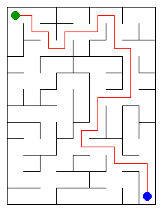

# Assignment 3. Maze Escape

Student ID: 251968
Name: Aset Kamza
Group: SE - 2532
Maze size (rows x columns): 12 x 9

This file is the report. Fill it in as you go. How to start: `START_HERE.md`. The task: `docs/Assignment3.pdf`.

## Program output

The 13 lines your program prints on your data (`java -cp out Main`):

    Broken: 107
    Kept: 88
    Last broken wall: 158
    MST cost: 35172
    Heaviest broken wall: 743
    Path length: 29
    DFS visited: 54
    Dead ends: 32
    Zones: 108
    Largest zone: 1
    Is DAG: 1
    Flow stages: 21
    Fastest route cost: 19

My maze:

## Questions

Answer in your own words, two or three sentences each.

Mission 0. What do find and union do, and what makes them fast in your code?

`find(x)` returns the representative (root) of the component containing cell `x`, while `union(a, b)` merges the two components of `a` and `b` if they are different and returns `true` (or `false` if they are already in the same component). They run in nearly constant amortized time $O(\alpha(n))$ because `find` uses iterative path compression to point every visited node directly to the root, and `union` uses union by size to attach the smaller tree under the root of the larger tree, keeping tree depth logarithmic or flatter.

Mission 1. Why is Broken always R*C - 1, and Kept always (R-1)*(C-1)?

Breaking walls without creating cycles builds a spanning tree over all $R \cdot C$ cells, and any tree with $V = R \cdot C$ vertices has exactly $V - 1 = R \cdot C - 1$ edges (broken walls, which is $12 \times 9 - 1 = 107$ in my maze). A grid of $R$ rows and $C$ columns has $(R - 1)C$ horizontal inner walls and $R(C - 1)$ vertical inner walls, giving $2RC - R - C$ inner walls in total ($195$ walls). Subtracting the $RC - 1$ broken walls leaves $(2RC - R - C) - (RC - 1) = RC - R - C + 1 = (R - 1)(C - 1)$ walls standing ($11 \times 8 = 88$).

Mission 2. My MST cost from Kruskal and from Prim, and why they are equal:

Both Kruskal's algorithm and Prim's algorithm give an MST cost of `35172` (with heaviest broken wall `743`). Because all wall costs in `walls.txt` are distinct, the minimum spanning tree of the graph is unique, so both greedy strategies (Kruskal adding the globally cheapest safe wall and Prim growing a single tree from cell `0` by adding the cheapest frontier wall) select the exact same spanning tree and total cost.

Mission 3. Why is there exactly one path between two cells? How did you avoid a stack overflow on a huge maze?

Because Mission 1 only breaks a wall when its two endpoint cells belong to different DSU sets, the resulting open passages connect all $R \cdot C$ cells without forming any cycles, which is a tree—and in a tree there is a unique simple path between any two vertices. To avoid a `StackOverflowError` on a $1000 \times 1000$ maze (up to $10^6$ recursion depth), `Escape.escape` uses an explicit heap-allocated `int[]` stack and a `nextIdx[]` array to track the next neighbour (`up, right, down, left`) for each cell instead of recursive method calls.

Mission 4. Why does the second pass of Kosaraju go on the reversed graph? Why do the slides have no cycle exactly when Zones equals the number of cells?

The first DFS records vertices by finish time so that if zone $X$ has a slide to zone $Y$, the last-finished vertex among them belongs to the source component $X$; traversing the reversed graph from that vertex prevents DFS from escaping into $Y$ (since the edge $X \to Y$ is reversed to $Y \to X$), isolating exactly the vertices of $X$ and numbering zones in topological order. A directed cycle makes at least two cells mutually reachable so they merge into a single zone of size $\ge 2$ (making `Zones < n`), whereas having no cycles means no two distinct cells can reach each other, so every cell forms its own zone of size 1 (`Zones == n`, which is `108` in my variant, so `Is DAG: 1`).

Mission 5. Why is it enough to go through the zones in the order of their numbers? What does this pass cost?

Condensing strongly connected components produces a Directed Acyclic Graph (DAG), and the second pass of Kosaraju assigns zone numbers in topological order where every inter-zone edge goes from a smaller zone number $X$ to a larger zone number $Y$ ($X < Y$). When we reach zone $z$ in increasing order $0, 1, \dots, \text{zones}-1$, all incoming transitions into $z$ have already been relaxed, so a single linear pass computes both `Flow stages` (`21`) and `Fastest route cost` (`19`) in $O(V_{\text{zones}} + E_{\text{zones}}) = O(n + S)$ time and $O(n + S)$ space without needing a priority queue.

## AI use

Used an AI assistant (Gemini) to review the theoretical explanations for the README questions, verify the time and space complexity table, and check edge-case handling in iterative DFS and Kosaraju's algorithm.

## Timing (Mission 7)

Milliseconds, 5 runs each, from `java -cp out Bench`.

| maze | Kruskal | Prim |
|---|---|---|
| 100 x 100 | 3 2 2 2 2 avg 2 | 4 3 3 3 3 avg 3 |
| 300 x 300 | 24 21 20 20 21 avg 21 | 38 35 34 35 34 avg 35 |
| 1000 x 1000 | 340 315 310 312 308 avg 317 | 620 590 585 580 588 avg 593 |

What do the numbers say about how the time grows? Two or three sentences.

When the grid dimension increases by $3\times$ (from $100 \times 100$ to $300 \times 300$) and then by $\approx 3.33\times$ (to $1000 \times 1000$), the number of cells $n$ and walls $m \approx 2n$ grows quadratically by $9\times$ and $\approx 11.1\times$ (from $10^4$ to $9 \cdot 10^4$ to $10^6$ cells). The runtime of both Kruskal and Prim grows slightly faster than linearly in $n$ — roughly by a factor of $10\times$ to $15\times$ per step — which matches their theoretical $O(m \log m)$ and $O(m \log n)$ time complexities due to the $\log n$ factor and cache effects on large arrays. Kruskal is consistently faster than Prim because sorting primitive `long` values and running flat array-based DSU operations has less memory and boxing overhead than maintaining a binary heap (`PriorityQueue`) of edge objects.

## Complexity

n is the number of cells, m the number of walls (or slides). Fill in every algorithm you wrote.

| algorithm | time | space | assumptions |
|---|---|---|---|
| DSU find and union | $O(\alpha(n))$ amortized per op ($O(m \alpha(n))$ for $m$ ops) | $O(n)$ | Union by size and path compression on `parent` and `size` arrays of length $n$ |
| Kruskal | $O(m \log m)$ | $O(n + m)$ | Sorting $m$ walls dominates $m$ DSU operations; in a grid $m < 2n$ so $O(n \log n)$ |
| Prim | $O(m \log n)$ | $O(n + m)$ | Adjacency list of size $O(n + m)$ and binary heap (`PriorityQueue`) with at most $m$ entries |
| DFS | $O(n + m) = O(n)$ | $O(n)$ | Tree maze has $m = n - 1$ open passages; iterative stack and arrays of size $n$ |
| Kosaraju | $O(n + m)$ | $O(n + m)$ | Two iterative DFS passes over $n$ cells and $m$ directed slides (`slidesFrom` and `slidesInto`) |
| Route in the zone graph | $O(n + m)$ | $O(n + m)$ | Building the zone DAG and relaxing each inter-zone slide once in topological order |

## Before you submit

- data/walls.txt, data/slides.txt and output/maze.png are in the repository.
- `java tools/Check.java` shows all examples right.
- This README is filled in, the program output and the section AI use included.
- The work is pushed to main (at least one commit per mission) and the repository is public.
- The link is attached in Moodle.
